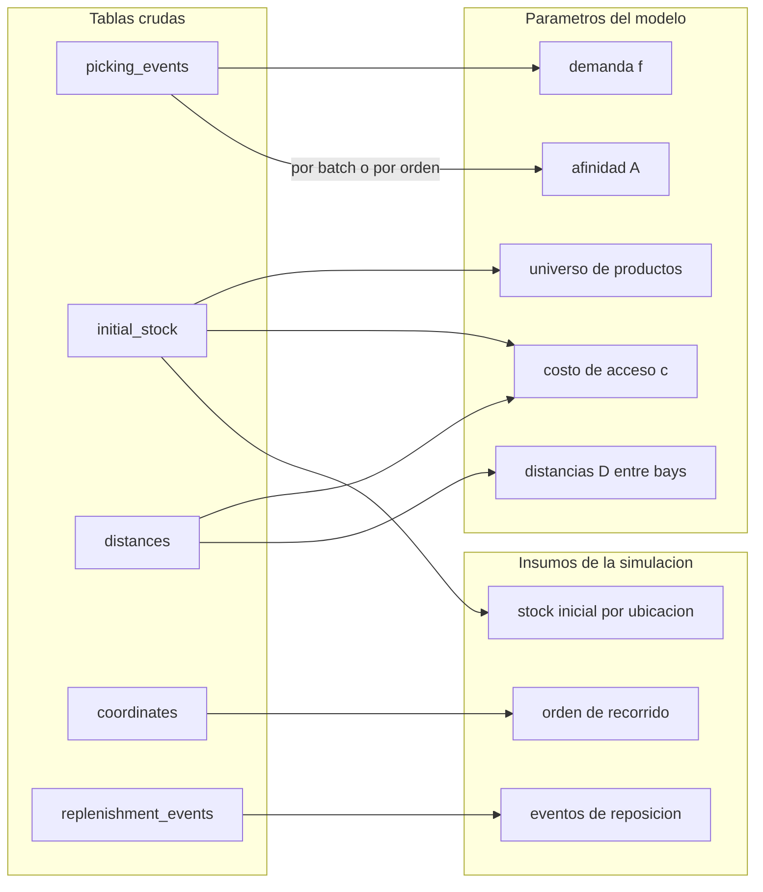
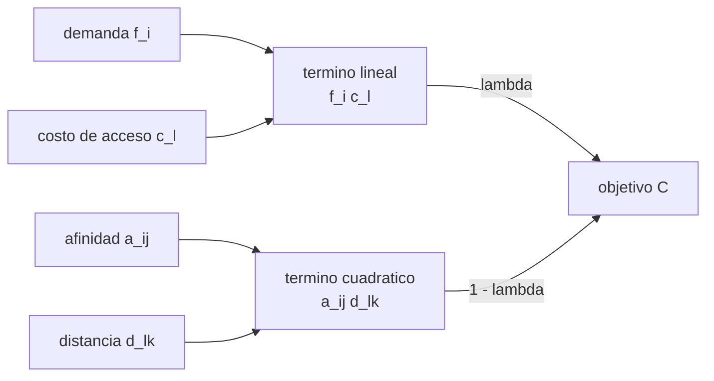

# El problema, los datos y el modelo

Define el problema, describe los datos y presenta la formulacion matematica. La estrategia
de resolucion esta en [metodo.md](metodo.md); la implementacion y el protocolo de medicion,
en [sistema.md](sistema.md).

---

## 1. El problema

En un centro de distribucion, el componente dominante del costo de preparar un pedido es
el desplazamiento del operario. La asignacion de productos a ubicaciones (*slotting*)
determina esos recorridos.

La practica habitual asigna ubicaciones por disponibilidad de hueco o por rotacion
individual de cada producto, sin considerar la relacion entre productos. Los pedidos
contienen pares de productos que aparecen juntos de forma recurrente; si esos pares quedan
almacenados lejos entre si, cada pedido que los incluye genera recorrido adicional.

El trabajo asigna ubicaciones combinando dos criterios en tension:

- **Demanda**: frecuencia con que se solicita cada producto. Los de mayor rotacion se
  ubican cerca de la zona de despacho.
- **Afinidad**: tendencia de dos productos a solicitarse juntos. Los pares afines se
  ubican proximos entre si, lo que puede alejar alguno del despacho.

Un parametro, lambda, pondera ambos criterios.

El problema pertenece a la familia **Storage Location Assignment Problem (SLAP)**, variante
*correlated storage assignment*. Su ubicacion en la literatura se desarrolla en
[estado-del-arte.md](estado-del-arte.md).

---

## 2. Los datos

Dos datasets sinteticos, generados por ShipHero a partir de un deposito real, con las mismas
cinco tablas parquet (`coordinates`, `distances`, `initial_stock`, `picking_events`,
`replenishment_events`). El primero, **v1** (abril de 2026), es un unico deposito con 30 dias
de historia. El segundo, **v2** (septiembre de 2026), viene en tres tamanos con seis meses de
historia cada uno y agrega a `picking_events` la columna `order_id`, que identifica la orden
del cliente a la que pertenece cada linea. La carpeta de cada dataset la resuelve
`dataset_dir(version, size)` en `config.py`; los notebooks de `notebooks/data2/` describen v2
en detalle.

| Concepto | v1 | v2 small | v2 medium | v2 big |
|---|---:|---:|---:|---:|
| Periodo | 30 dias | 6 meses | 6 meses | 6 meses |
| Pasillos x bays por lado | 25 x 20 | 4 x 10 | 8 x 16 | 16 x 24 |
| Pasillos transversales | 0 | 1 | 2 | 3 |
| Estantes x bins por bay | 5 x 6 | 4 x 6 | 5 x 6 | 6 x 6 |
| Ubicaciones | 30.000 | 1.920 | 7.680 | 27.648 |
| Productos ubicados (10% de huecos libres) | 27.000 | 1.728 | 6.912 | 24.883 |
| Merchants (vendors) | 10 | 4 | 50 | 100 |
| Pickers | 20 | 5 | 20 | 60 |
| Batches (viajes de picking) | 2.000 | 1.086 | 8.145 | 18.100 |
| Ordenes | no observables | 27.150 | 203.625 | 452.500 |
| Lineas de picking | 174.597 | 95.043 | 712.137 | 1.583.010 |
| Reposiciones (45% mudanzas) | 14.647 | 9.417 | 76.966 | 171.333 |

En v1 un batch tiene ~87 lineas y ~76 productos distintos, y la orden no es observable, aunque
el readme del generador indica que todas las lineas de una orden comparten merchant. En v2 cada
orden tiene entre 2 y 5 productos distintos de un unico merchant, con 1 a 3 unidades por linea;
un batch son 25 ordenes consecutivas por llegada, mezcla merchants y reune entre ~63 (`small`)
y ~86 (`big`) productos distintos. Esa distincion es la que hace observable la co-demanda: que
dos productos se compren juntos es un hecho de la orden, que se recolecten juntos es un hecho
del batch, y en v2 se puede medir lo primero y construir lo segundo con el tamano de lote que
se quiera.

Las distancias son camino minimo (Dijkstra) sobre el grafo de pasillos, en pulgadas; en v2 los
pasillos transversales acortan el paso entre pasillos vecinos a su altura. La conversion a
metros se usa solo en los reportes. El costo de acceso de una ubicacion es la distancia de su
bay al dock, y dos ubicaciones del mismo bay estan a distancia cero.

### 2.1 De las tablas a los parametros

La unidad sobre la que se cuenta la co-ocurrencia (batch u orden) es un parametro de
`build_cooccurrence` y de `build_full_instance` (`cooccurrence_col`). En v1 solo puede ser el
batch.

### 2.2 Particion train / test

Corte temporal a nivel de batch: cada batch se asigna integro a una particion segun su
timestamp; el 20% mas reciente constituye el test. El corte se hace a nivel de batch porque el
batch es la unidad de evaluacion; partirlo introduciria fuga de informacion entre particiones.
En v2 ninguna orden se reparte entre batches, asi que el corte tampoco parte ordenes.

| Dataset | Particion | Batches | Lineas | Ordenes |
|---|---|---:|---:|---:|
| v1 | Train | 1.600 | 139.632 | — |
| v1 | Test | 400 | 34.965 | — |
| v2 small | Train | 868 | 75.787 | 21.700 |
| v2 small | Test | 218 | 19.256 | 5.450 |

En v1 quedan 15.554 productos observados en train y 11.446 de los 27.000 del universo entran
al modelo con demanda cero. En v2 casi todo el universo se pide en train (3 productos sin
demanda en `small`). Los cortes de `medium` y `big` se agregan cuando se corran.

Los eventos de reposicion requieren un corte propio, descrito en
[sistema.md](sistema.md#75-el-corte-de-las-reposiciones).

### 2.3 Caracterizacion exploratoria

**v1** (notebook `data1/00_EDA`): la ocupacion es uniforme por pasillo, bay, estante y vendor;
la actividad de picking es uniforme por pasillo y por numero de bay; pickers y merchants estan
balanceados. El dataset no presenta estructura espacial ni de demanda que sesgue el analisis,
y tampoco estructura explotable mas alla de la distancia al despacho.

**v2** (notebook `data2/01_EDA_v2`): el volumen es constante mes a mes, siete dias por semana,
sin estacionalidad, y la popularidad de cada producto es estable entre meses. La demanda esta
moderadamente sesgada: entre el 16% y el 25% de los productos de un merchant explican el 80%
de sus picks. Todos los productos del stock se piden al menos una vez.

Sobre la co-demanda, v2 permite la verificacion que v1 no permitia: comparar la co-ocurrencia
por orden con la que producirian ordenes que eligen sus productos al azar segun la popularidad
de cada uno dentro del merchant. El resultado es que **no se distinguen**: para los pares con
al menos 20 co-ocurrencias esperadas, el cociente observado sobre esperado queda entre 0,65 y
1,19 (percentiles 5 y 99) en los tres tamanos, y ningun par supera 1,5. Los pares que mas
co-ocurren son los productos mas populares de cada merchant, en la cantidad que predice la
independencia. En v1, a nivel batch, pasa lo mismo. Hasta que se confirme con ShipHero como se
generan las ordenes, hay que asumir que **ninguno de los dos datasets tiene afinidad plantada**,
y que cualquier metodo que la optimice esta optimizando ruido.

---

## 3. Benchmark de referencia

Slotting vigente del deposito, evaluado sobre los batches de test. Para **v1** (400 batches):

| Metrica | Pulgadas | Metros |
|---|---:|---:|
| Total | 20.959.192 | 532.363 |
| Media por batch | 52.398 | 1.331 |
| Mediana por batch | 52.540 | 1.335 |
| p95 por batch | 57.233 | 1.454 |

Para **v2 small** (218 batches) la media del slotting vigente es 6.663 pulgadas por batch, con
un p95 de 6.664: con cuatro pasillos y unos 63 productos por batch el recorrido cubre el
deposito entero casi siempre, asi que `small` deja poco margen para que el slotting cambie
algo. Los benchmarks de `medium` y `big` se agregan cuando se corran.

Toda estrategia se reporta como reduccion porcentual respecto de la linea base de su dataset.

---

## 4. Formulacion matematica

### 4.1 Notacion

| Simbolo | Significado |
|---|---|
| $I$, $n = \lvert I \rvert$ | conjunto de productos a ubicar |
| $L$, $m = \lvert L \rvert$ | conjunto de ubicaciones candidatas, $m \ge n$ |
| $f_i \ge 0$ | demanda del producto $i$ (*pick lines*) |
| $c_\ell \ge 0$ | costo de acceso de la ubicacion $\ell$ (distancia al dock) |
| $a_{ij} \ge 0$ | afinidad entre los productos $i, j$; simetrica, $a_{ii} = 0$ |
| $d_{\ell k} \ge 0$ | distancia entre las ubicaciones $\ell, k$ (via sus bays); simetrica, $d_{\ell\ell} = 0$ |
| $x_{i\ell} \in \{0, 1\}$ | vale $1$ si el producto $i$ se ubica en $\ell$ |
| $\lambda \in [0, 1]$ | peso relativo entre demanda-acceso y afinidad-proximidad |

### 4.2 Programa cuadratico binario

$$
\min_{x}\;\; \lambda \sum_{i \in I} \sum_{\ell \in L} f_i\, c_\ell\, x_{i\ell}
\;+\; (1 - \lambda) \sum_{i \in I} \sum_{j \in I} \sum_{\ell \in L} \sum_{k \in L}
a_{ij}\, d_{\ell k}\, x_{i\ell}\, x_{jk}
$$

sujeto a

$$
\sum_{\ell \in L} x_{i\ell} = 1 \quad \forall i \in I, \qquad
\sum_{i \in I} x_{i\ell} \le 1 \quad \forall \ell \in L, \qquad
x_{i\ell} \in \{0, 1\}.
$$

El termino lineal modela la colocacion de los productos frecuentes en posiciones de bajo
costo de acceso. El termino cuadratico penaliza la colocacion distante de productos con
alta afinidad: cada par $(i, j)$ aporta su afinidad multiplicada por la distancia entre
las ubicaciones asignadas. Las restricciones imponen que cada producto ocupe exactamente
una ubicacion y que cada ubicacion aloje a lo sumo un producto; la desigualdad admite
ubicaciones vacias.

### 4.3 Relacion con el QAP y limite de escala

Restringida a las $n$ ubicaciones utilizadas, una solucion factible asigna a cada producto
una unica ubicacion y el costo adopta la forma de Koopmans-Beckmann del **Quadratic
Assignment Problem**, con termino lineal. El QAP es NP-hard; Loiola et al. (2007) situan
el limite practico de la resolucion exacta en instancias de tamano 30.

A la escala de v1 o de v2 `big` (unos 25.000 a 27.000 productos y 28.000 a 30.000
ubicaciones), una formulacion directa tendria $n \cdot m \approx 7$ a $8 \times 10^{8}$
variables binarias y una afinidad densa de $n^2 \approx 6$ a $7 \times 10^{8}$ entradas. Ni
siquiera v2 `small` entra: 1.728 por 1.920 son 3,3 millones de binarias, y el resolvedor exacto
deja de probar optimalidad en un minuto con unos 30 productos (notebook `data2/02_el_codigo`,
seccion 6b). De alli dos decisiones que atraviesan la implementacion:

1. **Afinidad dispersa**: $a_{ij}$ se almacena como matriz CSR restringida a los vinculos
   mas fuertes (top-$k$ por producto), reduciendo las entradas de $O(n^2)$ a $O(nk)$.
2. **Evaluacion incremental**: la busqueda local calcula la variacion de costo de cada
   movimiento, no el costo total.

### 4.4 Variacion de costo de un intercambio

Sea $\ell_i$ la ubicacion asignada al producto $i$. Al intercambiar las ubicaciones de dos
productos $a$ y $b$, la variacion $\Delta = C_{\text{despues}} - C_{\text{antes}}$ es,
con $a$ y $d$ simetricas y de diagonal nula:

$$
\Delta_{\text{lineal}} = (f_a - f_b)\,(c_{\ell_b} - c_{\ell_a}),
$$

$$
\Delta_{\text{cuad}} = 2 \sum_{k \neq a, b} (a_{ak} - a_{bk})\,
\bigl(d_{\ell_b, \ell_k} - d_{\ell_a, \ell_k}\bigr),
$$

$$
\Delta = \lambda\, \Delta_{\text{lineal}} + (1 - \lambda)\, \Delta_{\text{cuad}}.
$$

El factor $2$ cuenta cada par en sus dos ordenes y es valido por la simetria de $a$; la
instancia exige afinidad simetrica y lo valida en su construccion. El termino
$a_{ab}\, d_{\ell_a \ell_b}$ no varia por la simetria de $d$.

El calculo es $O(n)$ en el caso denso y $O(\deg(a) + \deg(b)) = O(k)$ con afinidad
top-$k$. Esta cota es la que hace viable la busqueda local a esta escala.

### 4.5 Costo marginal de una ubicacion

La politica de reposicion `objective_greedy`
([sistema.md](sistema.md#73-las-politicas-de-reposicion)) evalua el costo de colocar el
producto $s$ en la ubicacion $\ell$ dado el estado del deposito en ese instante:

$$
\text{costo}(\ell) = \lambda\, f_s\, c_\ell
\;+\; (1 - \lambda)\, 2 \sum_{j} a_{sj}\, \overline{d}(\ell, j)
$$

donde $j$ recorre los vecinos de afinidad de $s$ y $\overline{d}(\ell, j)$ es la distancia
media de $\ell$ a las ubicaciones que ocupa $j$ (un producto puede ocupar varias).

### 4.6 El objetivo como surrogate

$C$ guia la busqueda: se calcula sobre train y es barata de evaluar. El desempeno se
reporta con una medida distinta, la distancia de los recorridos simulados sobre test
([sistema.md](sistema.md#6-dos-medidas-distintas)). Optimizar y medir con la misma funcion
produciria una estimacion sesgada.

### 4.7 La escala de los dos terminos

Los dos terminos de $C$ no estan en la misma escala. El lineal suma picks por pulgadas y el
cuadratico suma afinidades, que con Jaccard son menores que 1, por pulgadas. Medido sobre una
subinstancia de 20 productos de v2 `small`, $L$ vale unos 7,8 millones y $Q$ unos 5 mil, una
relacion cercana a 1.500 a 1. Con $\lambda = 0{,}5$ el optimo exacto coincide con el de demanda
pura, y la afinidad solo empieza a mover la solucion alrededor de $\lambda = 0{,}01$. Los
barridos de v1 con $\lambda$ entre 0,3 y 0,7 fueron, en la practica, demanda pura.

La solucion adoptada (2026-09-09) es expresar $f$ y $a$ como **proporciones**: $f_i$ pasa a ser
la fraccion de los picks que se lleva el producto $i$ y $a_{ij}$ la fraccion del peso total de
afinidad que se lleva el par. Con eso $L$ es la distancia media al dock de un pick y $Q$ la
distancia media entre un par afin, ambas en pulgadas, y $\lambda = 0{,}5$ significa que las dos
distancias medias pesan igual. Vale para cualquier metrica de afinidad: la metrica decide que
pares pesan mas entre si y la normalizacion fija la escala. En el codigo es el parametro
`normalize=True` de `build_instance` y `build_full_instance`, aplicado despues del filtro; como
todo es lineal en $f$ y $a$, el objetivo, el delta de intercambio y la politica
`objective_greedy` no cambian. Sobre v2 `small` con el plan por demanda, $L$ y $Q$
normalizados valen unas 630 pulgadas cada uno. Los experimentos publicados de v1 no usaron esta
normalizacion y hay que repetirlos.

---

## 5. Alcance y simplificaciones

| Simplificacion | Implicacion |
|---|---|
| Distancia a nivel bay | Granularidad del dato. Dos productos en la misma bay quedan a distancia cero; el desplazamiento interno a la bay no se modela |
| Universo fijo de productos | Se ubican todos los presentes en el stock inicial; cobertura total de lo que aparece en test |
| Recorrido serpenteante, no TSP optimo | Aproxima la politica de ruteo real y separa la calidad del ruteo de la del slotting |
| Sin capacidad por ubicacion | El generador rellena "a capacidad" pero ninguna tabla exporta ese valor; al replicarse las cantidades del dato, los niveles la respetan por construccion |
| Sin costo de reposicion | Se contabiliza el desplazamiento del picker. El dataset no modela area de reserva, por lo que el recorrido del repositor no es derivable |
| lambda sin normalizar | Los dos terminos del objetivo difieren en unos tres ordenes de magnitud (seccion 4.7); los valores de lambda de los experimentos publicados no pesan la afinidad como su nombre sugiere |
| Afinidad sin senal en los datos | En v1 y v2 la co-ocurrencia observada es compatible con muestreo independiente por popularidad (seccion 2.3); las conclusiones sobre el aporte de la afinidad estan condicionadas a eso |

El trabajo comenzo con evaluacion estatica, que ignoraba las reposiciones. La evaluacion
vigente es una simulacion que las incorpora ([sistema.md](sistema.md#7-la-simulacion)).

---

## 6. Glosario

**Del deposito**

- **SKU** (producto): articulo distinto.
- **Location** (ubicacion): hueco fisico exacto, identificado por bay, estante y bin.
- **Bay**: columna de estanteria; unidad de distancia del modelo.
- **Dock**: estacion de empaque; inicio y fin de cada recorrido.
- **Orden**: pedido de un cliente; en v2, de 2 a 5 productos de un unico merchant. Unidad
  natural de la co-demanda; observable solo en v2.
- **Batch**: conjunto de ordenes recolectadas en una pasada; unidad de evaluacion, y unidad
  de co-ocurrencia cuando la orden no es observable.
- **Picking**: recoleccion de items para un pedido. **Slotting**: asignacion de una
  ubicacion a cada producto. **Reposicion**: reabastecimiento de stock, eventualmente con
  mudanza de ubicacion.

**Del modelo**

- **Demanda ($f$)**: frecuencia de solicitud de un producto, en *pick lines*.
- **Afinidad ($a$)**: grado en que dos productos se solicitan juntos.
- **Costo de acceso ($c$)**: distancia de una ubicacion al dock.
- **lambda**: peso relativo entre demanda y afinidad.
- **QAP**: Quadratic Assignment Problem. NP-hard.

**Del metodo**

- **Baseline**: metodo de referencia simple.
- **Heuristica**: metodo aproximado, sin garantia de optimalidad.
- **Surrogate**: funcion de costo que guia la busqueda, distinta de la metrica final.
- **Asignacion**: la propuesta producto-ubicacion que produce un metodo (el plan).
- **Estado**: el contenido fisico del deposito en un instante.
- **Politica de reposicion**: la regla que decide la ubicacion destino de las unidades
  repuestas.

---

## Referencias

- Koopmans, T.C. & Beckmann, M. (1957). *Assignment problems and the location of economic
  activities.* Econometrica, 25(1), 53-76.
- Loiola, E.M., de Abreu, N.M.M., Boaventura-Netto, P.O., Hahn, P. & Querido, T. (2007).
  *A survey for the quadratic assignment problem.* European Journal of Operational
  Research, 176(2), 657-690.
- Bartholdi, J.J. & Hackman, S.T. (2014). *Warehouse & Distribution Science* (Rel. 0.96).
  Georgia Institute of Technology.

La bibliografia del area esta en [estado-del-arte.md](estado-del-arte.md).
